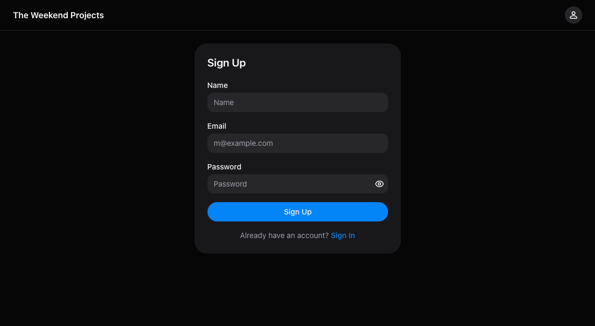

<div align="center">

# 🔐 emdash-better-auth

### Full authentication for [EmDash](https://emdashcms.com), powered by [Better Auth](https://better-auth.com)

Email/password + social login, passwordless, 2FA, passkeys, organizations, an
OIDC provider, Stripe billing, audit logging, a full account dashboard, and
**members-only / premium content with an optional site-wide sign-in wall** —
added to an EmDash site in **one line of config**, with **no database migrations**.

[](https://www.npmjs.com/package/emdash-better-auth)
[](./LICENSE)
[](https://emdashcms.com)
[](https://better-auth.com)

**[Live demo](https://theweekendprojects.com/auth/sign-up)** · **[npm](https://www.npmjs.com/package/emdash-better-auth)** · **[Quickstart](#quickstart)**



</div>

---

EmDash ships with passkey-only admin login. This plugin turns it into a full
auth backend for your **public app or membership site**: prebuilt, themed
sign-in / sign-up / account pages, and a long list of optional Better Auth
features you flip on from an admin settings page — no redeploy.

It registers as an EmDash `AuthProviderDescriptor`, so sign-ups become
first-class rows in EmDash's own `users` table (governed by EmDash RBAC). No
second user store, no `auth_*` tables, no migration files.

## Highlights

| | |
| --- | --- |
| 🧩 **One-line install** | `authProviders: [betterAuthProvider()]` adds sign-in, sign-up, reset, account, and the `/api/auth` handler. |
| 👤 **Real EmDash users** | Sign-ups land in EmDash's `users` table — no second store, no migrations. |
| 🎨 **Prebuilt themed UI** | HeroUI pages with a light / dark / system toggle, self-contained (won't touch your site's styles). |
| ⚙️ **Admin settings page** | Toggle every feature, set the canonical URL, and manage secrets from the admin UI — no redeploy. |
| ✉️ **Email verification** | On by default: blocks bot signups, re-sends on blocked login, auto-signs-in on click. |
| 🧰 **The Better Auth suite** | Social login, passwordless, 2FA, passkeys, API keys, organizations, OIDC provider, Stripe billing, audit log — all opt-in. |
| 🖥️ **Account dashboard** | One sidebar app for every signed-in user: profile, security, sessions and activity, plus Users and audit pages for admins. Menu follows the user's role. |
| 🔒 **Members-only & premium content** | A per-post "who can read this" dropdown. One extra line in `astro.config` gates pages, search, RSS and sitemaps — no theme edits. |
| 🏢 **Intranet mode** | One switch puts the whole site (pages, search, uploaded files) behind sign-in. |

## What is what

The package is one repo with five cooperating parts. You register the first two; the rest come with them.

| Part | You add it with | What it does |
| --- | --- | --- |
| **Auth provider** | `authProviders: [betterAuthProvider()]` | The engine: the Better Auth API at `/api/auth`, the pages under `/auth`, `/login`, `/signup`, `/account`, and the sign-in session bridge to EmDash. |
| **Settings plugin** | `plugins: [betterAuthSettingsPlugin()]` | The **Better Auth** page in the EmDash admin sidebar: every feature switch, credentials, and the "Add the Access field" button. Optional, but it is how you configure everything without a redeploy. |
| **Account dashboard** | comes with the provider | The signed-in area at `/account/*` (and `/admin`, `/organization`, `/audit-log`) in one sidebar layout. |
| **Content access** | `integrations: [..., betterAuthAccess()]` | Optional. Middleware that gates members-only and premium entries and the site-wide sign-in wall. |
| **UI extension point** | `vite: { plugins: [betterAuthUi(...)] }` | Optional. Add your own Better Auth UI settings tabs. |

## Quickstart

```bash
pnpm add emdash-better-auth
pnpm add -D @tailwindcss/vite            # required — compiles the auth-page styles
wrangler secret put BETTER_AUTH_SECRET   # required — openssl rand -base64 32
```

```js
// astro.config.mjs
import react from "@astrojs/react";
import tailwindcss from "@tailwindcss/vite";
import { betterAuthProvider, betterAuthSettingsPlugin } from "emdash-better-auth";

export default defineConfig({
  output: "server",
  vite: { plugins: [tailwindcss()] },          // required for the HeroUI auth styles
  integrations: [
    react(),                                    // auth pages are React islands
    emdash({
      /* ...your database / storage... */
      authProviders: [betterAuthProvider()],    // sign-in/up, /auth/*, /account/*
      plugins: [betterAuthSettingsPlugin()],    // optional: admin settings page
    }),
  ],
});
```

Deploy, then open `/login` or `/signup`.

> **Email verification is on by default**, so a working email provider is
> required or new users can't finish signing up. See [Email](#email). Everything
> beyond email/password is optional — turn features on from the settings page.

## Requirements

- **EmDash** `>=0.30.0`, on **Cloudflare Workers** (D1 + R2). Other adapters are untested.
- **`@astrojs/react`** and **`@tailwindcss/vite`** wired into your Astro config — both required. The auth pages are React islands, and HeroUI ships Tailwind v4 source that your site compiles. Without Tailwind the pages render unstyled.
- **React** `>=19.2.6` / **react-dom** `>=19.2.6` (HeroUI peer).

> **pnpm cooldown:** the `@better-auth-ui/*` packages release often. If you set a
> pnpm `minimumReleaseAge`, add `"@better-auth-ui/*"` to
> `minimumReleaseAgeExclude` in `pnpm-workspace.yaml`.

## Routes

All injected for you — don't create your own `login.astro` / `signup.astro` /
`api/auth/*`, they'd collide.

| Route | Purpose |
| --- | --- |
| `/api/auth/[...all]` | Better Auth API (sign-in, callbacks, get-session, sign-out, …) |
| `/auth/[...path]` | Sign-in, sign-up, forgot/reset password, verify email, sign-out |
| `/login`, `/signup` | Friendly aliases |
| `/account/[...path]` | The signed-in dashboard: Home (staff), profile, security, sessions & activity, API keys, connected apps, OAuth clients, billing, Users (admin). Login-gated. |
| `/admin/[...path]` | User management — only when *admin* is enabled, admins only |
| `/organization/[...path]` | Org / team management — only when *organizations* is enabled |
| `/audit-log` | Site-wide auth event log — only when *audit logging* is enabled, admins only |

**Two login doors, on purpose.** EmDash's passkey login at
`/_emdash/admin/login` stays untouched. The Better Auth pages are an *additional*
email/password door. A Better Auth account **is** an EmDash user, so an admin
(role ≥ 50) can sign in through either and get full CMS access. Don't redirect
`/_emdash/admin/login` to Better Auth unless every admin has an email/password
credential — passkey-only admins would be locked out.

## Configuration

Set these as **Cloudflare Worker secrets** (`.env` is build-time only and not
available to the deployed Worker):

| Variable | Required | Notes |
| --- | --- | --- |
| `BETTER_AUTH_SECRET` | **Yes** | Session signing key. `openssl rand -base64 32`. |
| `BETTER_AUTH_URL` | Multi-domain only | Canonical origin for email links (see below). |
| `<PROVIDER>_CLIENT_ID` / `_SECRET` | Per social provider | e.g. `GOOGLE_CLIENT_ID`. Provider turns on when both are set. |
| `STRIPE_SECRET_KEY` / `STRIPE_WEBHOOK_SECRET` | Billing only | Plus `STRIPE_PRICE_<PLAN>_MONTH` / `_YEAR` per plan. |
| `GENERIC_OAUTH_CONFIG` | Extra OIDC only | JSON array of extra OAuth/OIDC providers. |

Everything except `BETTER_AUTH_SECRET` can also be set from the admin settings
page, and a saved setting wins over its env var.

### Base URL (canonical origin)

Verification / reset **emails** contain absolute links, so the plugin needs a
canonical origin. It resolves one, in order:

1. `BETTER_AUTH_URL` (or `BETTER_AUTH_BASE_URL`) env var.
2. Astro's `site:` config, if set.
3. The request origin (zero-config, single-domain).

> **Multi-domain / proxied sites must set tier 1 or 2.** If the app answers on
> more than one host (custom domain *and* `*.workers.dev`, or behind a proxy),
> the request origin is ambiguous and would bake the wrong host into email
> links. Set `site:` (also fixes canonical URLs / RSS) or `BETTER_AUTH_URL`. The
> incoming origin stays trusted, so logging in via the other host still works.

### Session lifetime (recommended)

EmDash stores the signed-in user in the Astro session, whose cookie is a
browser-session cookie by default — it vanishes on browser restart, while Better
Auth's cookie lasts 7 days. The plugin re-bridges automatically when it notices
the mismatch, but matching the lifetime avoids the extra redirect:

```js
// astro.config.mjs → emdash() is an Astro integration; this is Astro's own session option
session: { cookie: { maxAge: 60 * 60 * 24 * 7 }, ttl: 60 * 60 * 24 * 7 },
```

## Admin settings page

Register `betterAuthSettingsPlugin()` (shown in the quickstart) to add a
**Better Auth** entry to the admin sidebar. From there you toggle features and
manage credentials with no redeploy. Precedence per field: **saved setting > env
var > built-in default**, so leaving a field blank falls back gracefully.

Feature toggles (all **off** by default except email verification):

| Feature | Default | What it adds |
| --- | --- | --- |
| Email verification (+ resend, auto sign-in) | **on** | Blocks unverified login. |
| Allow new sign-ups | **on** | Turn off to make the site invite-only: every account-creating path answers `403 SIGN_UP_DISABLED`; existing users still sign in and admins can still add users. |
| Social sign-in | off | Google, GitHub, Facebook, X, Cloudflare — per provider. |
| Two-factor (TOTP) | off | Authenticator-app 2FA + backup codes. |
| Passkeys (WebAuthn) | off | Passwordless biometric / security-key sign-in. |
| API keys | off | User-created programmatic keys (stored hashed). |
| Admin user management | off | `/admin` — create/ban/impersonate, roles. |
| Organizations (+ teams) | off | `/organization` — multi-tenant orgs, invites. |
| OIDC / OAuth 2.1 provider | off | Make this site an identity provider for other apps. |
| Magic link / Email OTP | off | Passwordless email link or one-time code. |
| Guest (anonymous) sessions | off | "Continue as guest", claim an account later. |
| Multiple accounts per browser | off | Hold several accounts, switch between them. |
| Extra OAuth / OIDC providers | off | Keycloak, Okta, Auth0, … via `GENERIC_OAUTH_CONFIG`. |
| Breached-password check (HIBP) | off | Reject passwords found in known breaches. |
| Audit logging (+ retention) | off | `/audit-log` — auth events with IP, UA, severity. |
| Stripe billing | off | Subscription billing + a Billing tab per account. |
| Let users delete their own account | off | A Delete account card on the profile page. Refused while the user still owns an organization. |
| Sessions kept per user | 25 (`0` = unlimited) | Newest N sessions are kept per user, so the "where you are signed in" list stays complete. A number field, not a toggle. |
| Members-only and premium content | **on** | Master switch for the `access` field rules below. Off = every entry is public and the premium controls disappear. |
| Require sign-in to view the site | off | Intranet mode, see [below](#intranet-mode-require-sign-in-to-view-the-site). |

The page also has one button, **Add the Access field to my content types**, see [Members-only and premium content](#members-only-and-premium-content).

### Social sign-in

Each provider turns on only when **both** its client ID and secret are set (env
vars or the settings page). Create an OAuth app in the provider's console and
register the callback URL — the settings page shows it per provider, ready to
copy:

```
https://<your-domain>/api/auth/callback/<provider>
```

`<provider>` is `google`, `github`, `facebook`, `twitter` (for X), or
`cloudflare`. Adding another is a two-line change: add it to `SOCIAL_PROVIDERS`
in `settings.ts` and the `SocialProviderId` union in `auth.ts`; keys, env
fallbacks, admin card, and callback URL all derive from that.

## Email

Better Auth doesn't send email; it hands the plugin a link, which goes out
through EmDash's email pipeline (`runtime.email`). So verification and password
reset need a configured `email:deliver` provider — e.g.
[`emdash-smtp`](https://github.com/masonjames/emdash-smtp) (Resend, SES, SMTP).
Add it to `emdash({ plugins: [...] })`, pick it in **Admin → Settings → Email**,
and set its key (e.g. `RESEND_API_KEY`) as a Worker secret.

> **Email verification is mandatory by default.** A new account can't sign in
> until the emailed link is clicked, so **without an email provider, signup is a
> dead end**. Configure email before going live, or turn *Require email
> verification* off in the settings page. In dev, EmDash's console provider logs
> the link to the terminal. Password reset fails quietly (never crashes) when no
> provider is set.

## Account dashboard and roles

After sign-in, users land in one sidebar app. The menu is built from the features that are switched on and from the
user's role, so a customer never sees developer pages.

| Group | Pages | Who sees it |
| --- | --- | --- |
| Home | Dashboard cards, statistics, latest users | Staff (EmDash role 20+) |
| Workspace | Content editor link, plus tabs your own Better Auth UI plugins add (see [Extending the UI](#extending-the-ui-with-your-own-better-auth-ui-plugins)), Organizations, Active organization | Content editor: staff. Others: everyone signed in, when the feature is on |
| Account | Profile, Security (password, linked accounts, 2FA, passkeys), Sessions & activity, API keys, Connected apps, OAuth clients, Billing | Everyone; API keys, Connected apps and OAuth clients: staff only |
| Administration | Users (search, add, CSV export, delete, Make premium), User management, Audit log | Admins (role 50) |

EmDash roles: subscriber `10` (every sign-up), contributor `20`, author `30`, editor `40`, admin `50`. A subscriber is sent
to the first workspace page after sign-in (or the profile). Pages a role may not see answer 404/403; the menu is a
convenience, the server still enforces access.

**Sessions & activity** shows each device and IP (Cloudflare's `cf-connecting-ip` is used first), with a sign-out per
session, and the recent sign-ins and failed attempts when audit logging is on.

## Members-only and premium content

Mark individual posts or pages so only signed-in readers, or only premium readers, can open them. No EmDash core change
and no theme edits.

**1. The field.** Each entry carries an `access` select field with the values `public` (default), `members`,
`premium`. Authors set it in the editor sidebar ("Who can read this"). Add the field to your content types once:
EmDash admin → **Better Auth** → **Add the Access field to my content types** (skips types that already have it, safe to
click twice). Theme seed files can also declare it.

**2. The switch-on line.**

```js
// astro.config.mjs
import { betterAuthAccess } from "emdash-better-auth/access-integration";

integrations: [react(), emdash({ /* ... */ }), betterAuthAccess()],   // list it after emdash()
```

**3. What readers get.**

| Reader | `members` entry | `premium` entry |
| --- | --- | --- |
| Signed out | redirect to `/auth/sign-in?redirect=<page>`, back to the page after sign-in | same |
| Signed in | readable | `403` paywall page (title and teaser only), "Upgrade" button |
| Premium user | readable | readable |
| Staff (role 20+) | everything | everything |

- **Premium** is a flag on the user (`premium`), switched by an admin with **Make premium** on the Users page, or set
  by your own billing code through the admin API. It is not a Stripe feature by itself.
- **Search, RSS and sitemaps** drop entries the reader may not open. Pages that depend on who is looking are sent
  `Cache-Control: private, no-store`.
- **HTML lists** (home, `/posts/`, tags) still show the *title* of a protected entry (a teaser). To hide them from lists,
  call `filterEntries` in the theme (below).
- The entry is found through the collection's URL pattern (must contain `{slug}`), cached 30 s per host.
- Cost: about 20 to 30 ms on a public entry page.
- Switching **Members-only and premium content** off in settings makes everything public again; the field values stay.

**Theme helpers (optional).** Only needed to hide protected entries from HTML lists, or when you cannot use the
integration:

```ts
import { filterEntries, gateEntry, isLocked } from "emdash-better-auth/access";

const { entry } = await getEmDashEntry("posts", slug);
const blocked = await gateEntry(Astro, entry);   // before rendering
if (blocked) return blocked;
const visible = await filterEntries(Astro, entries);   // in lists, feeds, tag pages
```

If a theme calls them as well as the integration, both agree; nothing is checked wrongly twice.

## Intranet mode: "Require sign-in to view the site"

For internal documentation. Settings → **Require sign-in to view the site** (needs `betterAuthAccess()`). When on:

- Signed-out visitors are redirected from every themed page (pages, lists, RSS, sitemaps) to `/auth/sign-in?redirect=<page>`.
- `/_emdash/api/search`, search suggest, comments and **uploaded files** (`/_emdash/api/media/file/*`, so images and PDFs)
  answer `401`. Signed-in readers get uploaded files with `private, max-age=3600`: the browser keeps them, no shared cache does.
- Left open: `/auth`, `/api`, `/account`, `/admin`, `/organization`, the EmDash admin and its own APIs, built assets.

Read this before relying on it:

- **"Signed in" means any account.** Turn *Allow new sign-ups* **off** and create the accounts yourself, otherwise a
  stranger can register and read everything.
- Files in your site's `public/` folder are served by Cloudflare's static-assets layer without running your Worker, so
  the wall cannot cover them. Keep internal files in the media library.
- Pages that were cached publicly before you switched it on can be served from the CDN for their cache time (an hour on
  many themes). Purge the cache when enabling it on a site that was public.
- Settings are cached 10 s per site, so a switch takes up to about 10 s to apply.

## Security notes

- Email codes and magic-link tokens are stored **hashed**, not in plain text.
- API keys are stored hashed. Optional breached-password check (HIBP) sends only the first 5 characters of the password's
  SHA-1 hash.
- The sign-in form cannot submit natively before React has loaded (that would put the password in the URL); the page
  blocks such a submit.
- Account deletion is off by default and refused while the user owns an organization.
- Secrets saved in the admin settings page are stored unencrypted in the database; see the Gotchas below.
- Content access runs in middleware; it fails open only if the entry cannot be resolved (then the theme answers on its
  own). Unknown `access` values are treated as `members`.

## Extending the UI with your own Better Auth UI plugins

Better Auth UI plugins can add **settings tabs** (an extra tab on `/account`), **avatar-menu items** and routable
sub-pages. To add your own, point the package at a module that default-exports an array of plugins, with the
`betterAuthUi()` Vite plugin:

```ts
// astro.config.mjs
import { betterAuthUi } from "emdash-better-auth/vite";

export default defineConfig({
  vite: { plugins: [betterAuthUi({ plugins: "./src/better-auth-ui.ts" })] },
});
```

```ts
// src/better-auth-ui.ts
import { createAuthPlugin } from "@better-auth-ui/core";
import { Billing } from "./Billing"; // your React component

const myPlugin = createAuthPlugin("my-plugin", () => ({
  viewPaths: { settings: { billing: "billing" } },                // /account/billing
  settingsTabs: [{ view: "billing", label: "Billing", component: Billing }],
}));
export default [myPlugin()];
```

Every view this package renders (sign-in, account, admin, organization, audit log) registers the plugins, and the
`/account` and `/auth` pages allow the view paths the plugins declare under `viewPaths.settings` / `viewPaths.auth`.
Without `betterAuthUi()` the list is empty and nothing changes.

## Gotchas

- **Browser autofill on secret fields.** A password manager may fill the Better
  Auth secret, Stripe, and social-credential fields with junk. To prevent a
  stray save from clobbering a good value, those fields are **locked by
  default** — flip the per-section "Edit" toggle to change them, and the save
  path refuses to write a locked field. If a bad value did get saved, clearing
  the field won't remove it (blank = keep existing); delete the row directly:
  `DELETE FROM options WHERE name = 'plugin:better-auth-settings:settings:betterAuthSecret';`
- **Secrets are stored in the DB, not encrypted at rest** (the mask only hides
  the UI), same as `emdash-smtp`. For the session signing key this is weaker
  than a Worker secret — if the DB leaks, sessions can be forged. **Prefer
  leaving the "Better Auth secret" field blank and keeping `BETTER_AUTH_SECRET`
  as a Worker secret.**
- **Sign-out ends every account** on the browser when *multiple accounts* is on
  (Better Auth's own behavior). To sign out of just one, use the per-account
  action in the account page's "Manage accounts".
- **No migrations, but EmDash core migrations must have run.** On a fresh site:
  register the provider, set `BETTER_AUTH_SECRET`, deploy, load a page once so
  EmDash applies its own migrations. Don't expect `auth_*` tables — there are
  none.

## How it works

- **User model → EmDash `users` table** via a custom Better Auth adapter, with
  field mapping (`emailVerified` → `email_verified`, `image` → `avatar_url`, …).
  New sign-ups default to the lowest role (subscriber, `10`), so hitting
  `/signup` never grants admin.
- **account / session / verification → EmDash plugin storage**
  (`getAuthProviderStorage`, namespace `auth:better-auth`). No custom tables;
  indexes are created at runtime from the storage config.
- **Auth pages are a React island** rendering Better Auth UI, pointed at
  `/api/auth`. HeroUI styles compile via Tailwind and load **only** on these
  routes.
- **Session bridge.** On sign-in the route writes EmDash's own session cookie,
  so the login is recognized site-wide (admin included, subject to role). With
  multiple accounts, EmDash follows whichever account is active.
- **Username is always required** (public identity, unique, stored in plugin
  storage); email stays required for recovery but is never shown publicly.
- **Bio + avatar** live in `users.data` / `avatar_url` — no new columns. Avatar
  is a resized data URL (R2-backed upload is a planned follow-up).

## Exports

| Export | What |
| --- | --- |
| `.` | `betterAuthProvider()`, `betterAuthSettingsPlugin()`, `createBetterAuth`, `emdashAdapter`, `PROVIDER_ID`, `ROLE_SUBSCRIBER` |
| `./client` | Better Auth browser client (`authClient`) |
| `./ui` | `AuthView` React island |
| `./route`, `./auth`, `./adapter`, `./settings-plugin` | Lower-level pieces (injected automatically) |
| `./pages/*` | The injected Astro pages |
| `./admin` | "Continue with EmDash" button for EmDash's admin login |
| `./vite` | `betterAuthUi({ plugins })` Vite plugin: your own Better Auth UI plugins, plus the source patches this package needs |
| `./ui-plugins` | The (empty by default) list of Better Auth UI plugins the views register |
| `./access-integration` | `betterAuthAccess()` Astro integration: content access and the sign-in wall |
| `./access-middleware` | The middleware that integration registers (do not import it yourself) |
| `./access` | Theme helpers: `gateEntry`, `filterEntries`, `isLocked`, `markPrivate`, `entryAccess`, `decide`, `listed` |

## Upgrading to 0.12

- New files and dependencies (`@fontsource-variable/inter`) come with the package; run your package manager's install.
- The account area is now one dashboard app. `/admin`, `/audit-log` and `/organization` render inside it; nothing to change.
- New settings default to the old behaviour: members-only content on (it only acts on entries that have an `access`
  field), sign-in wall off, delete account off, 25 sessions kept per user.
- Optional: add `betterAuthAccess()` to `integrations` to use content access; see above.

## License

MIT
